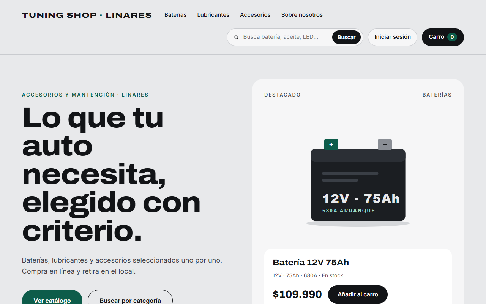
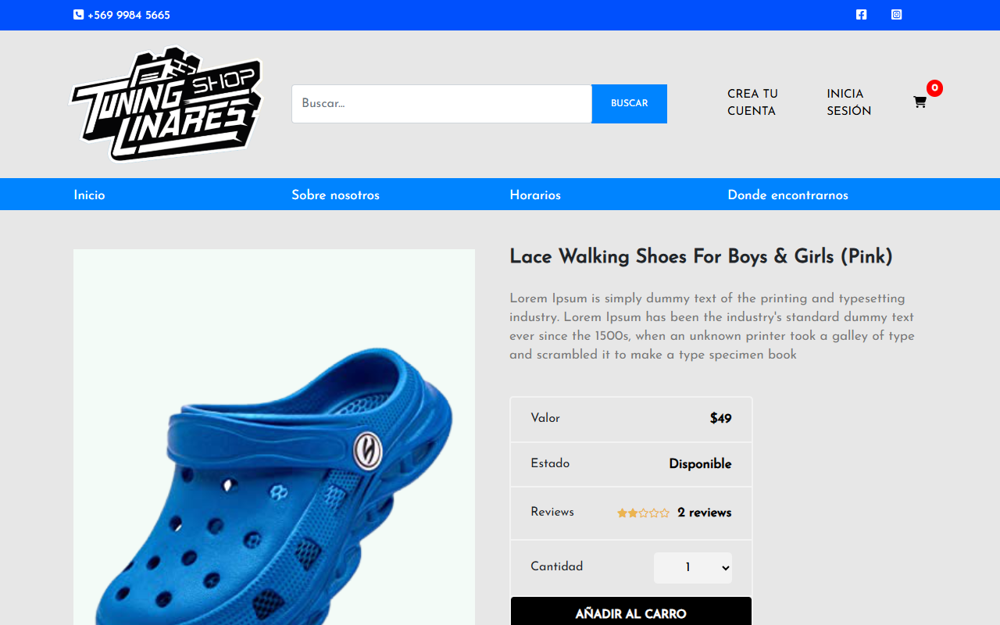
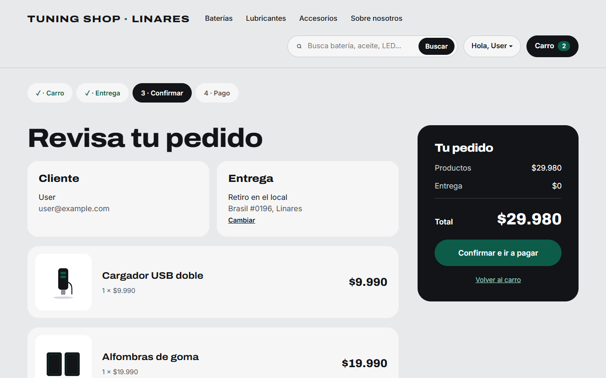
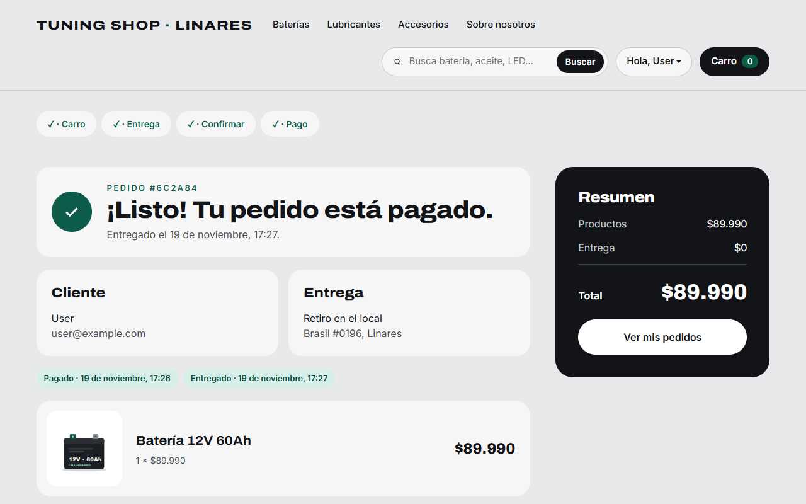
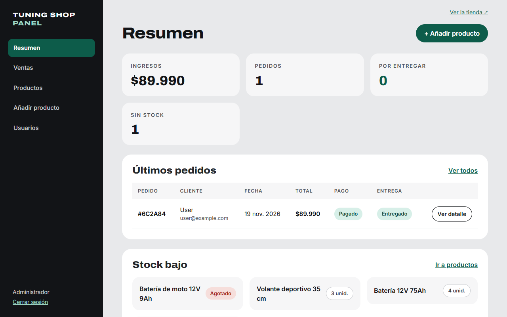
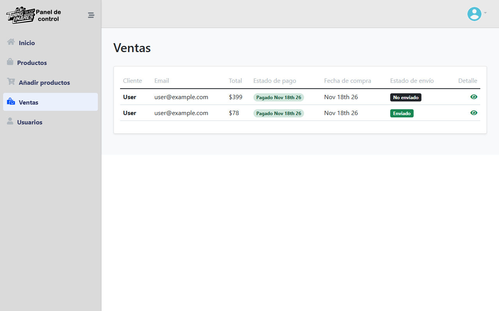
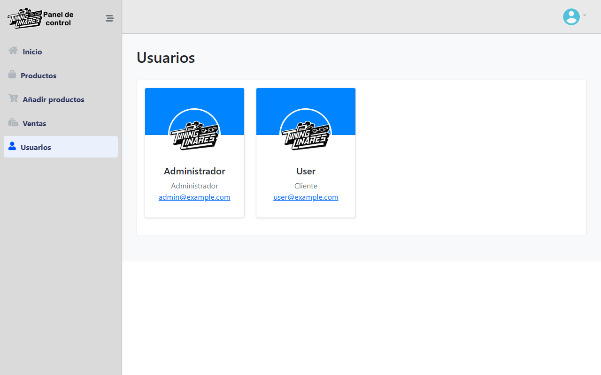
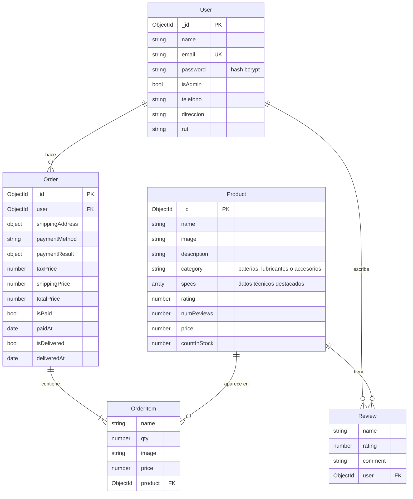

<p align="center">
  
</p>

# Tunning Shop Linares

[](https://github.com/Jose94D/Seminario-de-titulo-E-commerce/actions/workflows/ci.yml) [](LICENSE)

Tienda online para un local de tuning y accesorios automotrices de Linares, Chile. Los clientes navegan el catálogo, arman su carrito y pagan con **PayPal**; el dueño administra productos, pedidos y usuarios desde un **panel de administración** aparte.

Está hecha con el stack **MERN**: una API en **Express** sobre **MongoDB**, y dos aplicaciones **React** con **Redux** (la tienda y el panel).

> **Estado:** versión 2, en desarrollo. Parte del proyecto de **seminario de título** presentado en 2023 y lo moderniza: imágenes optimizadas, correcciones de seguridad, un rediseño completo y tests automáticos.
>
> **Versión original:** el proyecto tal como se presentó en 2023 está en la rama [`tesis-2023`](../../tree/tesis-2023) y en el tag [`v1.0-tesis`](../../releases/tag/v1.0-tesis).

## Capturas

Versión 2, con el rediseño «Taller premium» y el catálogo de ejemplo (productos, precios e ilustraciones de demostración). Las capturas de la versión presentada en 2023 están en la rama [`tesis-2023`](../../tree/tesis-2023).

<!-- Sin tabla: en una tabla GitHub ajusta cada columna al texto y las imágenes quedan de distinto tamaño. -->
<p align="center">
  
  
</p>
<p align="center">
  
  
</p>
<p align="center">
  
  
</p>

* **Catálogo:** categorías (baterías, lubricantes y accesorios), búsqueda por nombre y paginación de 12 productos.
* **Producto:** precio, stock, especificaciones técnicas, valoración y reseñas de los clientes.
* **Compra:** carro, entrega (retiro en el local o despacho), confirmación y pago con PayPal, con un botón para simular el pago en la demo.
* **Mi cuenta:** pedidos con su estado y datos del cliente (incluido RUT, teléfono y dirección).
* **Local:** páginas de horario de atención, ubicación con un mapa de Google embebido y sobre nosotros.

### Panel de administración

<p align="center">
  
  
</p>
<p align="center">
  
  
</p>
<p align="center">
  
  
</p>

* **Acceso:** login solo para cuentas de administrador.
* **Resumen:** ingresos, pedidos, pedidos por entregar, productos sin stock, últimos pedidos y productos con stock bajo.
* **Productos:** crear, editar y eliminar, con categoría, stock y vista previa de la imagen.
* **Pedidos:** listado, detalle y marcar como entregado.
* **Usuarios:** listado de clientes registrados.

## Funciones

**Ya funcionan:**

* Registro e inicio de sesión con **JWT** y contraseñas cifradas con **bcrypt**.
* Carrito guardado en el navegador y flujo de compra en pasos.
* Pago con el botón de **PayPal** y registro del resultado en el pedido.
* Reseñas de productos con recálculo de la valoración promedio.
* Rutas privadas en la tienda y en el panel, y rutas de la API protegidas por usuario y por rol de administrador.
* Carga de datos de ejemplo (usuarios y productos) desde la API.

## Seguridad

Lo que tiene:

* Contraseñas con hash **bcrypt**; nunca se devuelven en las respuestas.
* Token **JWT** firmado con una clave del `.env`, exigido en las rutas privadas.
* Las rutas de administración exigen además `isAdmin`.
* Credenciales (MongoDB, PayPal, JWT) fuera del código, en archivos `.env`.
* Un pedido solo lo ve o lo marca como pagado su dueño o un administrador; a los demás la API responde 404, sin revelar que existe.
* Marcar un pedido como entregado es exclusivo de administradores.
* Las rutas `/api/import`, que reemplazan usuarios y productos con los de ejemplo, solo existen cuando `NODE_ENV` no es `production`.
* Los precios de un pedido se calculan en la API con los de la base de datos; del navegador solo se toman el producto y la cantidad, que no puede superar el stock.
* Validación de los datos de entrada (email, largo de la contraseña, campos obligatorios, precios y stock no negativos, valoración de 1 a 5): los datos inválidos reciben 400 con un mensaje en español, no un error 500.
* Login y registro solo aceptan texto en email y contraseña, lo que evita inyectar operadores de MongoDB como `{ "$gt": "" }`.
* Límite de intentos: tras 5 logins fallidos para un mismo email desde una misma IP, la API responde 429 durante 15 minutos.
* CORS restringido a los orígenes de la tienda y el panel (`CORS_ORIGINS`).

Corregido en 2026, después de la entrega: en la versión presentada cualquier usuario con sesión podía ver, pagar o marcar como entregado un pedido ajeno, y `/api/import` quedaba abierto también en producción. Además, un token válido de un usuario ya eliminado provocaba un error 500; ahora responde 401. Los precios de cada pedido los enviaba el navegador y la API los guardaba sin revisarlos, y guardar un usuario sin cambiar su contraseña volvía a cifrar el hash.

Pago en modo demo: el pedido se marca como pagado con los datos que envía el navegador tras el botón de PayPal, a propósito, para poder probar la compra completa. En producción, la API confirmaría el pago directamente con PayPal antes de marcarlo.

Pendiente:

* El token se guarda en `localStorage`; una cookie `httpOnly` lo protegería mejor ante un XSS.

## Tecnología

| Pieza | Elección |
| --- | --- |
| API | **Node.js**, **Express 4**, express-async-handler, morgan |
| Base de datos | **MongoDB Atlas** con **Mongoose 6** |
| Autenticación | **jsonwebtoken**, **bcryptjs** |
| Tienda | **React 17**, **Vite**, **Redux** + redux-thunk, React Router 5, axios, CSS propio (Archivo + Inter) |
| Panel admin | **React 17**, **Vite**, **Redux** + redux-thunk, React Router 5, axios, Bootstrap 5.3 con tema propio |
| Pagos | react-paypal-button-v2 (PayPal) |
| Extras | Mapa embebido de Google, react-toastify (panel) |
| Tests | node:test + Supertest (API), Vitest + Testing Library (tienda), GitHub Actions |

```text
 Cliente  ───► Tienda React  (:3000) ──┐
                                        ├──► API Express (:5000) ──► MongoDB Atlas
 Admin    ───► Panel React   (:4000) ──┘          │
                                                   └──► PayPal (client ID para el botón)
```

### Base de datos



## Tests

Cada push a `main` corre en GitHub Actions los tests y compila las dos apps.

* **API** (`server/test`, con `node:test`, Supertest y una MongoDB en memoria): login, registro, rutas privadas, token de un usuario eliminado, filtro por categoría y búsqueda, permisos de administrador y acceso a pedidos ajenos; y, en `security.test.js`, CORS, validación de datos, inyección de operadores, precios calculados en la API y límite de intentos.
* **Tienda** (Vitest y Testing Library): formato de precios en pesos chilenos, carro de compras y tarjeta de producto.

```bash
cd server && npm test
cd "client frontend" && npm test
```

## Ejecutar

Requisitos: Node.js 20.19 o superior y una base MongoDB (local o Atlas). Las apps React usan **Vite**: `npm run dev` levanta el servidor de desarrollo y redirige `/api` a la API en el puerto 5000; `npm run build` deja la versión de producción en `build/`.

API:

```bash
cd server
npm install
copy .env.example .env
npm run server
```

`server/.env`:

| Variable | Uso |
| --- | --- |
| `PORT` | Puerto de la API. Las apps React esperan `5000`. |
| `NODE_ENV` | `development` o `production`. |
| `JWT_SECRET` | Firma los tokens. Usa una cadena larga y aleatoria. |
| `PAYPAL_CLIENT_ID` | Client ID de una app PayPal (sandbox para pruebas). |
| `MONGO_URL` | Cadena de conexión de MongoDB. |
| `CORS_ORIGINS` | Orígenes de la tienda y el panel, separados por coma. Por defecto, `http://localhost:3000,http://localhost:4000`. |

Con la API corriendo y `NODE_ENV=development`, carga los datos de ejemplo (borra los existentes):

```bash
curl -X POST http://localhost:5000/api/import/user
curl -X POST http://localhost:5000/api/import/products
```

Quedan dos cuentas de prueba, `admin@example.com` (administrador) y `user@example.com`, ambas con la contraseña `password`.

Tienda (en otra terminal, abre `http://localhost:3000`):

```bash
cd "client frontend"
npm install
npm run dev
```

Panel de administración (abre `http://localhost:4000`):

```bash
cd dashboard
npm install
npm run dev
```

En producción, `VITE_STORE_URL` define la dirección de la tienda para el enlace «Ver la tienda» del panel.

## Estructura

```text
├── server/                 API Express
│   ├── config/             conexión a MongoDB
│   ├── Models/             User, Product, Order
│   ├── Routes/             /api/users, /api/products, /api/orders
│   ├── Middleware/         protect, admin y manejo de errores
│   ├── data/               usuarios y productos de ejemplo
│   ├── test/               tests de la API
│   ├── app.js              la app Express (sin conexión ni puerto)
│   └── DataImport.js       rutas /api/import
├── client frontend/        tienda (React + Redux)
│   └── src/
│       ├── screens/        páginas: inicio, producto, carrito, pago, perfil…
│       ├── components/     header, footer, paginación, reseñas
│       └── Redux/          actions, reducers, constants y store
├── dashboard/              panel de administración (React + Redux)
│   └── src/
│       ├── screens/        resumen, productos, pedidos, usuarios
│       ├── components/
│       └── Redux/
└── docs/                   capturas, banner e informe del seminario (PDF)
```

## Nota de uso

Proyecto académico. Los productos y las cuentas son datos de ejemplo, y para probar los pagos conviene usar una app PayPal en modo sandbox. El informe completo del seminario está en [`docs/informe-seminario.pdf`](docs/informe-seminario.pdf).

## Licencia

[MIT](LICENSE).
