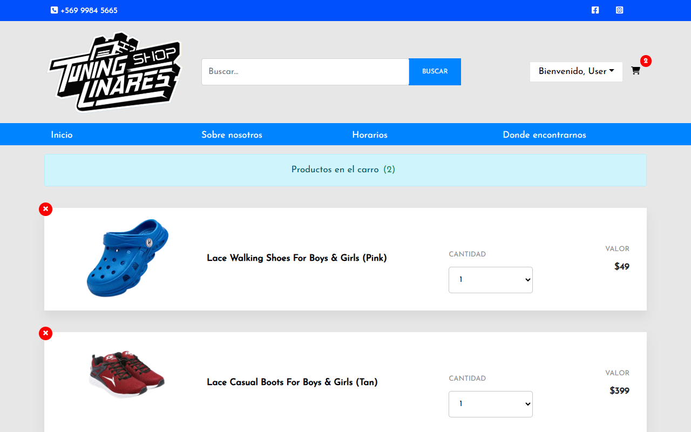
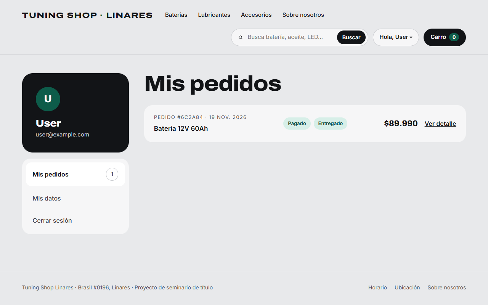
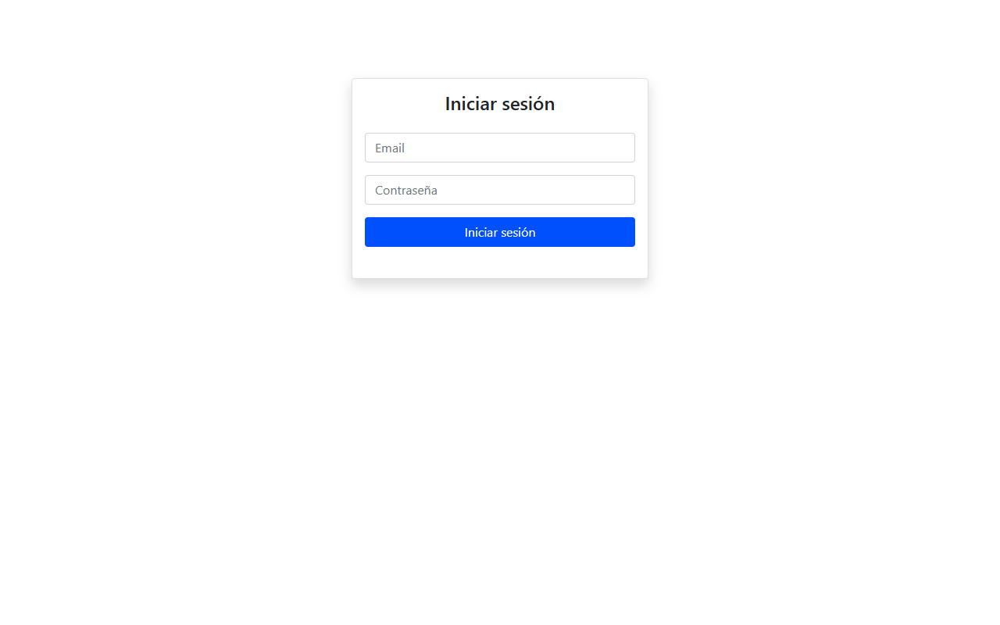
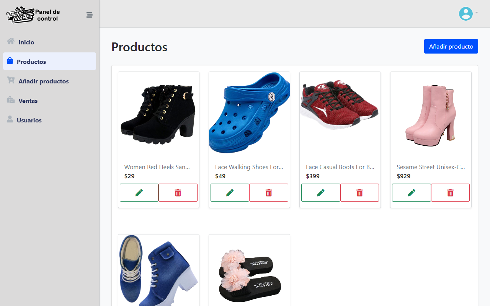
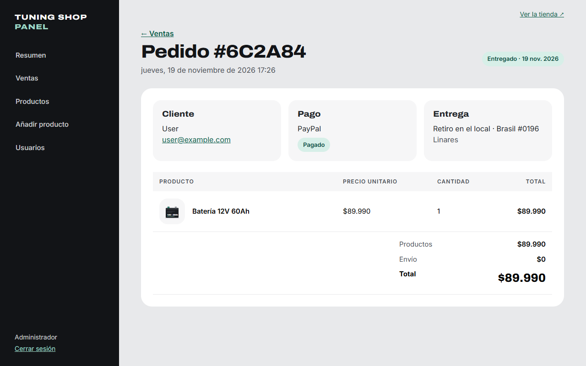
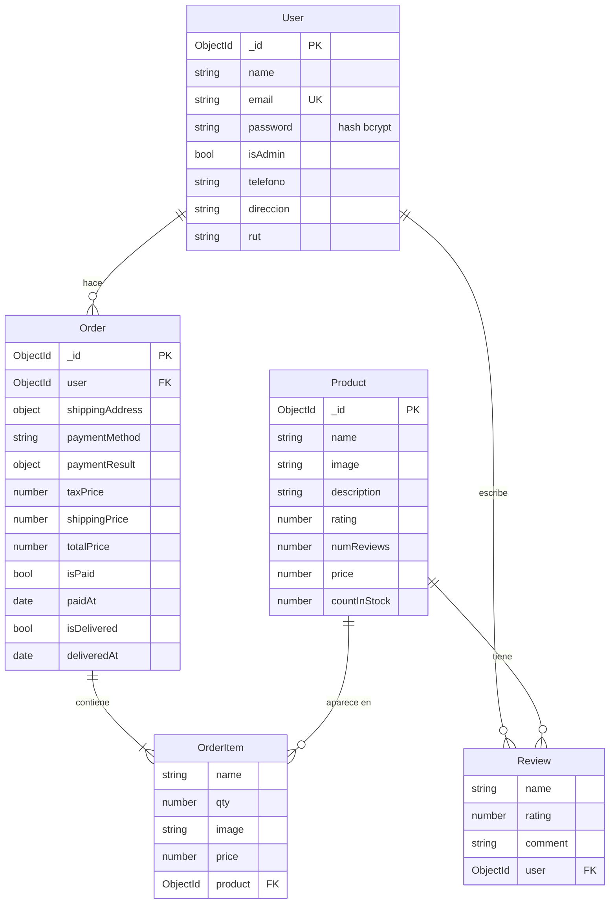

<p align="center">
  
</p>

# Tunning Shop Linares

Tienda online para un local de tuning y accesorios automotrices de Linares, Chile. Los clientes navegan el catálogo, arman su carrito y pagan con **PayPal**; el dueño administra productos, pedidos y usuarios desde un **panel de administración** aparte.

Está hecha con el stack **MERN**: una API en **Express** sobre **MongoDB**, y dos aplicaciones **React** con **Redux** (la tienda y el panel).

> **Versión de tesis (2023), congelada.** Esta rama conserva el proyecto de **seminario de título** tal como se presentó en 2023, con lo mínimo para publicarlo (credenciales fuera del código y este README). No recibe cambios.
>
> **Versión nueva:** la versión 2, con optimizaciones, correcciones de seguridad y rediseño, está en la rama [`main`](../../tree/main).

## Capturas

Con los productos y cuentas de ejemplo del proyecto (por eso el catálogo muestra calzado).

<!-- Sin tabla: en una tabla GitHub ajusta cada columna al texto y las imágenes quedan de distinto tamaño. -->
<p align="center">
  
  
</p>
<p align="center">
  
  
</p>
<p align="center">
  
  
</p>

* **Catálogo:** búsqueda por nombre y paginación de 12 productos.
* **Producto:** precio, stock, valoración y reseñas de los clientes.
* **Compra:** carrito, dirección de envío, método de pago, resumen y pago con PayPal.
* **Perfil:** datos del cliente (incluido RUT, teléfono y dirección) e historial de pedidos.
* **Local:** páginas de horario de atención, ubicación con Google Maps y sobre nosotros.

### Panel de administración

<p align="center">
  
  
</p>
<p align="center">
  
  
</p>
<p align="center">
  
  
</p>

* **Acceso:** login solo para cuentas de administrador.
* **Resumen:** totales de ventas, pedidos y productos, últimos pedidos y gráficos embebidos de **MongoDB Charts** (dependían del cluster de Atlas original, que ya no existe, así que hoy quedan cargando).
* **Productos:** crear, editar y eliminar.
* **Pedidos:** listado, detalle y marcar como entregado.
* **Usuarios:** listado de clientes registrados.
* **Categorías:** solo maqueta visual, no está conectada a la API.

## Funciones

**Ya funcionan:**

* Registro e inicio de sesión con **JWT** y contraseñas cifradas con **bcrypt**.
* Carrito guardado en el navegador y flujo de compra en pasos.
* Pago con el botón de **PayPal** y registro del resultado en el pedido.
* Reseñas de productos con recálculo de la valoración promedio.
* Rutas privadas en la tienda y en el panel, y rutas de la API protegidas por usuario y por rol de administrador.
* Carga de datos de ejemplo (usuarios y productos) desde la API.

## Seguridad

Lo que tiene:

* Contraseñas con hash **bcrypt**; nunca se devuelven en las respuestas.
* Token **JWT** firmado con una clave del `.env`, exigido en las rutas privadas.
* Las rutas de administración exigen además `isAdmin`.
* Credenciales (MongoDB, PayPal, JWT, Google Maps) fuera del código, en archivos `.env`.

Problemas conocidos, que dejo documentados en vez de corregirlos para conservar el proyecto como se entregó:

* `POST /api/import/user` y `POST /api/import/products` no piden sesión y **reemplazan** usuarios y productos. Solo para uso local.
* `GET /api/orders/:id` no comprueba que el pedido sea del usuario que lo pide.
* El token se guarda en `localStorage` y CORS acepta cualquier origen.

## Tecnología

| Pieza | Elección |
| --- | --- |
| API | **Node.js**, **Express 4**, express-async-handler, morgan |
| Base de datos | **MongoDB Atlas** con **Mongoose 6** |
| Autenticación | **jsonwebtoken**, **bcryptjs** |
| Tienda | **React 17**, **Redux** + redux-thunk, React Router 5, axios |
| Panel admin | **React 17**, **Redux** + redux-thunk, React Router 5, axios |
| Pagos | react-paypal-button-v2 (PayPal) |
| Extras | Font Awesome, react-toastify, Google Maps, MongoDB Charts |

```text
 Cliente  ───► Tienda React  (:3000) ──┐
                                        ├──► API Express (:5000) ──► MongoDB Atlas
 Admin    ───► Panel React   (:4000) ──┘          │
                                                   └──► PayPal (client ID para el botón)
```

### Base de datos



## Ejecutar

Requisitos: Node.js y una base MongoDB (local o Atlas). El proyecto se hizo con Node 16 y en 2026 se volvió a levantar con Node 26. Con versiones nuevas de Node, `npm start` de las apps React puede fallar con `options.allowedHosts[0] should be a non-empty string`, un error conocido de `react-scripts` 5 con la opción `proxy`; en ese caso se pueden compilar con `npm run build` y servir la carpeta `build/`.

API:

```bash
cd server
npm install
copy .env.example .env
npm run server
```

`server/.env`:

| Variable | Uso |
| --- | --- |
| `PORT` | Puerto de la API. Las apps React esperan `5000`. |
| `NODE_ENV` | `development` o `production`. |
| `JWT_SECRET` | Firma los tokens. Usa una cadena larga y aleatoria. |
| `PAYPAL_CLIENT_ID` | Client ID de una app PayPal (sandbox para pruebas). |
| `MONGO_URL` | Cadena de conexión de MongoDB. |

Con la API corriendo, carga los datos de ejemplo (borra los existentes):

```bash
curl -X POST http://localhost:5000/api/import/user
curl -X POST http://localhost:5000/api/import/products
```

Quedan dos cuentas de prueba, `admin@example.com` (administrador) y `user@example.com`, ambas con la contraseña `password`.

Tienda (en otra terminal, abre `http://localhost:3000`):

```bash
cd "client frontend"
npm install
copy .env.example .env
npm start
```

`client frontend/.env` necesita `REACT_APP_GOOGLE_MAPS_KEY` para la página de ubicación.

Panel de administración (abre `http://localhost:4000`):

```bash
cd dashboard
npm install
npm start
```

## Estructura

```text
├── server/                 API Express
│   ├── config/             conexión a MongoDB
│   ├── Models/             User, Product, Order
│   ├── Routes/             /api/users, /api/products, /api/orders
│   ├── Middleware/         protect, admin y manejo de errores
│   ├── data/               usuarios y productos de ejemplo
│   └── DataImport.js       rutas /api/import
├── client frontend/        tienda (React + Redux)
│   └── src/
│       ├── screens/        páginas: inicio, producto, carrito, pago, perfil…
│       ├── components/     header, footer, paginación, reseñas
│       └── Redux/          actions, reducers, constants y store
├── dashboard/              panel de administración (React + Redux)
│   └── src/
│       ├── screens/        resumen, productos, pedidos, usuarios
│       ├── components/
│       └── Redux/
└── Informe de seminario.docx
```

## Nota de uso

Proyecto académico. Los productos y las cuentas son datos de ejemplo, y para probar los pagos conviene usar una app PayPal en modo sandbox. El informe completo del seminario está en `Informe de seminario.docx`.

## Licencia

La información sobre la licencia y las condiciones de uso se incorporará más adelante.
